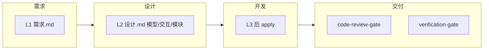

# 工作流剧本

把 Skill、Agent、Rule 串成可复述的端到端流程。入口见 `workflow-triggers` Rule。

## 四条主工作流

| 工作流 | 文件 | 典型口令 |
|--------|------|----------|
| **需求** | [requirements.md](./requirements.md) | 提需求、需求定稿 |
| **设计** | [design.md](./design.md) | 能力设计、模型/模块、UI 方向 |
| **开发** | [development.md](./development.md) | 实现、修 bug |
| **交付** | [delivery.md](./delivery.md) | 验收、准备 PR |

新能力默认走 **project-spec**：L1 需求 →（复杂）**L2 设计确认** → L3 实现方案 → apply → 验收 → archive。

无 OpenSpec 的仓：`requirements-refinement` →（复杂）`设计.md` 确认 → `plan-workflow` → 再编码。

## 如何选择

| 你想做什么 | 从哪条开始 |
|------------|------------|
| 新能力、先出方案 | `project-spec`（复杂先 L2 设计） |
| 先定模型/模块/交互/怎么拆 | 设计工作流 → `设计.md` |
| 先做界面观感 | `project-spec-design` |
| 记住/写成规则 | `knowledge-extract` |
| 写中文需求文档 | 需求 → `requirements-refinement` |
| 定 UI 观感 | `project-spec-design` |
| 写代码、改接口 | 开发（须 L2/L3 已过） |
| 声称做完、要 PR | 交付 → `verification-gate` |
