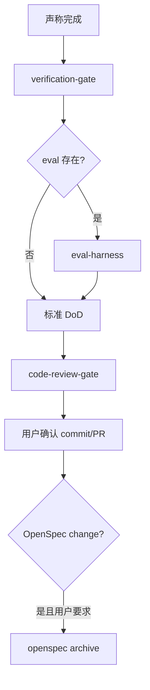

# 交付工作流

> **目标**：可重复的 DoD。每次声称完成或 stop hook 时执行。

## 入口口令

- 「交付工作流」「验收」「DoD」「准备 PR」

## 流程图

## 阶段

| 阶段 | Skill / Agent | 产出 |
|------|----------------|------|
| 1 验证 | `verification-gate`；改 backend 则 `backend-verify` | DoD |
| 2 审查 | `code-review-gate` · `@code-reviewer` | 审查意见 |
| 3 归档 | `project-spec` archive（用户确认后） | 主 spec 更新 |
