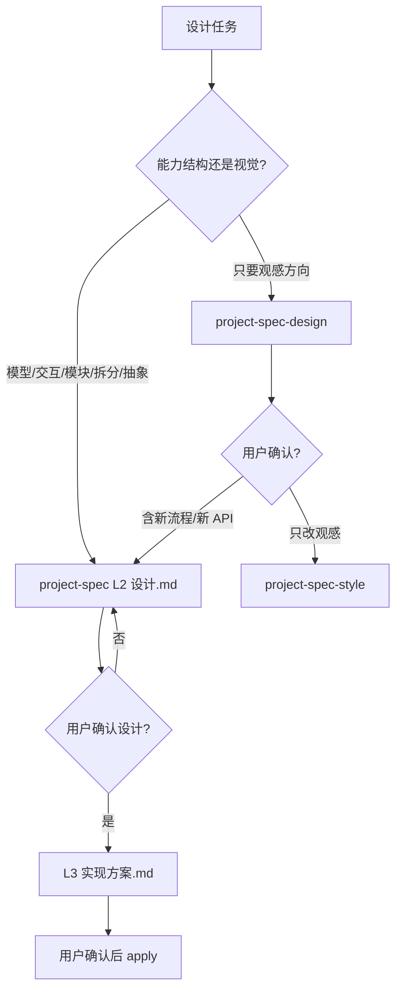

# 设计工作流

> **目标**：复杂需求在编码前先定结构（模型、交互、模块、拆分、抽象、原则）。视觉方向是另一条线。

## 入口口令

- 「先设计」「模块怎么分」「模型怎么定」「怎么拆」「交互怎么走」→ `project-spec` **设计阶段**（`设计.md`）
- 「走设计工作流」「UI 设计」「这一页更好看」→ `project-spec-design`
- 「改样式」「调间距」→ `project-spec-style`

## 流程图

## 阶段

| 阶段 | Skill / Agent | 产出 |
|------|----------------|------|
| 0 能力设计 L2 | `project-spec` 设计阶段 · `@architect` | `设计.md`（组合式含切片契约）；本轮不写业务代码、不写文件清单冒充设计 |
| 1 施工稿 L3 | `project-spec` propose / `plan-workflow` | `实现方案.md` |
| 2 视觉（可选） | `project-spec-design` | 界面方向，不替代 L2 |
| 3 文档 | `@doc-sync` | API / 数据模型 / ADR |

## 栈

- React Web：`frontend-react.mdc`、`react-*.mdc`、`typescript-*.mdc`
- Vue：`frontend-vue.mdc`、`vue-*.mdc`、`typescript-*.mdc`
