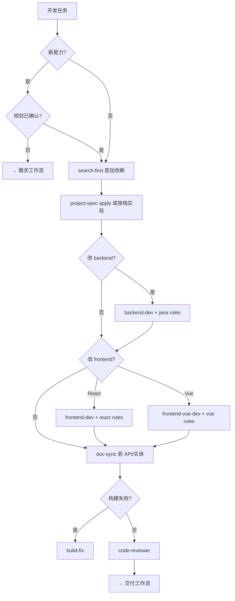

# 开发工作流

> **目标**：在门禁满足的前提下实现，审查后进入交付。

## 入口口令

- 「按开发工作流」「开始实现」「改接口」
- 「修 bug」→ `project-spec-fix`
- 「改样式」→ `project-spec-style`
- 「构建失败」→ `build-fix`

## 前置门禁（新能力）

- [ ] OpenSpec change 已 propose 且用户确认 apply；或需求 + `plan-workflow` 已定稿
- [ ] 用户明确「直接做」并接受文档滞后时，可跳过规划

小改 / bug：走 `project-spec-fix`，可跳过全量需求沉淀。

## 流程图

## 阶段

| 阶段 | Skill / Agent | Rules | 产出 |
|------|----------------|-------|------|
| 0 依赖 | `search-first` | `common-security.mdc` | 依赖决策 |
| 1 实现 | `project-spec` apply；`@backend-dev` / `@frontend-dev` / `@frontend-vue-dev` | 见栈 Rules | 代码 |
| 2 构建 | `build-fix` | 栈 patterns | 构建 PASS |
| 3 契约 | `@doc-sync` | `api-contracts.mdc` | design 同步 |
| 4 审查 | `code-review-gate` · `@code-reviewer` | `common-code-review.mdc` | 审查意见 |
| 5 后端深验 | `backend-verify` · `@qa-engineer` | `backend-spring.mdc` | 重启 + 冒烟 |

### 栈 Rules

| 改动路径 | Rules |
|----------|-------|
| `backend/**` | `backend-spring.mdc`、`java-*.mdc`、`api-contracts.mdc` |
| React | `frontend-react.mdc`、`react-*.mdc`、`typescript-*.mdc` |
| Vue | `frontend-vue.mdc`、`vue-*.mdc`、`typescript-*.mdc` |
| `docs/design/**` | `docs-maintenance.mdc`、`api-contracts.mdc` |
