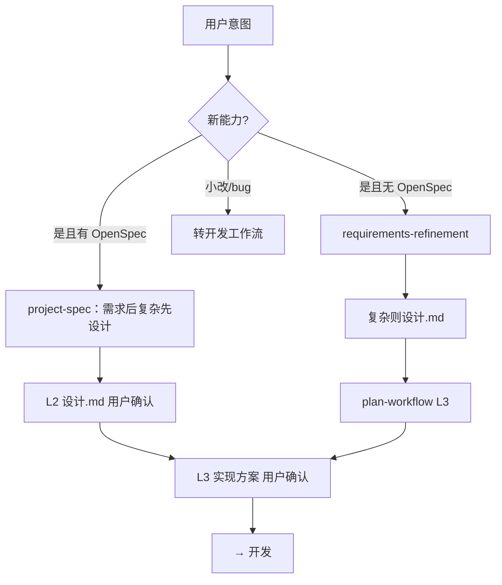

# 需求工作流

> **目标**：从模糊想法到可实现的规划。新能力禁止未确认就编码。

## 入口口令

- 「按需求工作流」「提需求」「需求定稿」「先出方案」

## 流程图

## 阶段

| 阶段 | Skill / Agent | 产出 | 门禁 |
|------|----------------|------|------|
| 0 需求 L1 | `requirements-refinement` / `project-spec` | `需求.md` | 用户确认前不写业务代码 |
| 1 设计 L2 | `project-spec` 设计阶段（复杂必做） | `设计.md` | 未确认不得写 L3 施工、不得 apply |
| 2 方案 L3 | `plan-workflow` / propose | `实现方案.md` | L2 已过或已声明跳过 |

## 禁止

- 新能力未确认规划就改业务代码
- 把 OpenSpec proposal 当成已实现
